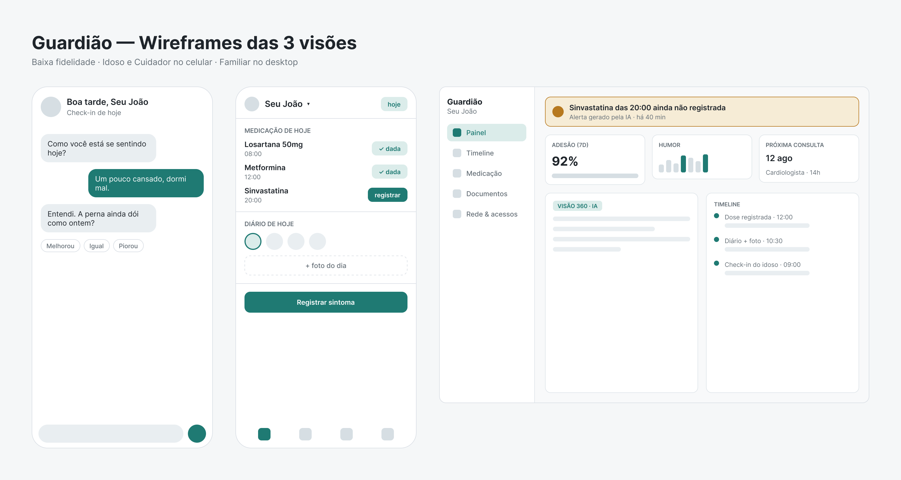
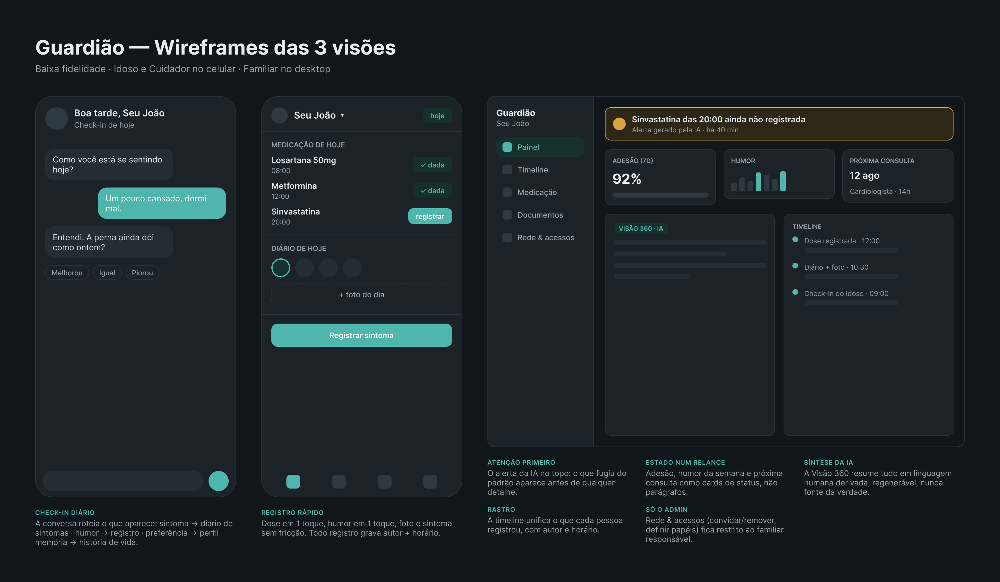

# 🛡️ Guardião


[](https://guardiao-smoky.vercel.app)

Um defensor digital para a velhice: uma plataforma de coordenação de cuidado do idoso com apoio de IA, que centraliza os dados de saúde e rotina, dá transparência ao familiar responsável e preserva a dignidade, as preferências e a vontade da pessoa idosa.

> Projeto Supervisionado de Extensão · INFNET · Engenharia de Software · Prof. Ricardo Frohlich da Silva

## Links

- 🌐 Aplicação no ar: https://guardiao-smoky.vercel.app
- 🎨 Wireframes (Figma): https://www.figma.com/design/3j2vkqR72G4LJr4CKZDhFa
- 🗂️ Planejamento e timesheet (Notion): https://app.notion.com/p/3b05307df3558154a1a4ec358fa8c919
- 💻 Repositório: https://github.com/LuisaHering/guardiao

## Sobre o projeto

O cuidado de idosos costuma ser fragmentado: as informações ficam espalhadas entre cadernos, grupos de mensagem e prontuários de clínicas diferentes, e o familiar que não está presente todo dia tem dificuldade de acompanhar e de confiar que a vontade da pessoa está sendo respeitada. O Guardião reúne tudo num lugar só, quem cuida registra o dia a dia, o familiar acompanha à distância, e a IA sintetiza uma visão sempre atualizada. A IA atua como assistente (organiza, resume, alerta), nunca como decisora.

**Cliente e beneficiário:** uma família real. Meu avô é o idoso (sujeito dos dados), a cuidadora dele registra o dia a dia, e eu sou a familiar responsável (administradora).

## Status (Semana 16 de 18)

| Fase | Foco | Status |
|------|------|--------|
| P0 | Fundações, modelagem, repositório e deploy | ✅ Concluída |
| P1 | Autenticação, papéis, perfil e núcleo do cuidado | ✅ Concluída |
| P2 | IA, documentos e visão 360 | ✅ Concluída |
| P3 | Dashboard, identidade e loop conversacional | ✅ Concluída |
| P4 | Hardening, teste com usuário real e entrega | ⏳ A seguir |

A primeira semana foi de idealização do projeto (definição de tema, cliente e escopo). O planejamento completo, a divisão em cards e a timesheet ficam no Notion.

### Já funciona

- Login, cadastro e sessão (Supabase Auth)
- Papéis e permissões: idoso, cuidador e familiar administrador, com controle de acesso por linha no banco (RLS)
- Perfil do idoso: dados, condições, alergias e contatos de emergência
- Consentimento LGPD do titular para tratamento de dados de saúde
- Convite de cuidadores e familiares por link, com aceite
- Medicação: cadastro de remédios, registro diário de adesão, motivo de não-adesão e alerta de silêncio
- Diário do cuidador: entradas diárias com foto do dia (Storage privado)
- Sintomas: registro com gravidade e histórico
- Perfil de emergência com QR revogável, acessível sem login
- Timeline unificada do idoso (diário, sintomas, medicação, consultas e exames em um só lugar)
- Consultas com áudio guardado e resumo estruturado por IA a partir do texto da consulta
- Receitas: foto ou PDF vira sugestão de remédios, conferida antes de cadastrar
- Exames: extração por IA, conferência de todos os valores de uma vez e conversão de unidade explícita
- Gráfico de tendência por analito, com a faixa de referência de cada laudo
- Observações por IA sobre sintomas, diário e medicação, com a evidência de cada uma
- Diretivas antecipadas: questionário guiado, PDF assinável e versionado, imutável depois de gerado, com registro de quem preencheu
- Visão 360: panorama feito por IA que mostra relatos divergentes sem decidir quem tem razão, e aponta o que ainda não dá para saber
- Alertas com estado de leitura por pessoa: exame fora da faixa, alergia nova, mudança de medicação e silêncio de registro (a cuidadora é avisada primeiro e, se persistir, a família)
- Painel do familiar: adesão da semana, alertas, últimos registros e exames fora da faixa
- Pauta médica: lista de dúvidas para a próxima consulta, com origem e data
- Preferências e história de vida ("como quero ser tratado"), com quem afirmou cada registro
- Score de completude do perfil, com sugestão do que preencher a seguir
- Folha "como cuidar de mim" em PDF, para quem começa a cuidar; os fatos de segurança (alergias, medicação, contatos) vêm do banco, e a IA só redige as preferências
- Documentos do idoso: pastas e arquivos (certidão, carteirinha do plano, RG), com acesso de quem cuida decidido documento a documento, mais pastas automáticas que reúnem exames, receitas, consultas e diretivas já salvos
- Onboarding por papel: boas-vindas curtas e cartão de primeiros passos que se marca sozinho
- Remédios com horários e frequência, cada dose registrada à parte; o que quem não administra adiciona, muda ou suspende vale na hora, e o administrador recebe um pop-up para aprovar ou negar (negar desfaz)
- Tela Hoje de quem cuida, pensada para o celular: checklist do dia e botões grandes; o administrador cria tarefas diárias, semanais ou de uma vez só
- Ida ao médico para quem cuida: gravar a consulta (com proteções e aviso de interrupção) ou contar o que o médico disse, documentos para levar, foto de papéis e volta marcada que vira tarefa
- Foto do dia: quem cuida tira a foto pela tela Hoje, a família vê no painel; armazenamento privado, sem local da foto e sem envio à IA
- Atalho na tela Hoje para enviar uma receita ou um pedido de exame novo
- Menu por papel (o cuidador vê só o operacional) e navegação adaptada ao celular
- Chat de cuidado com resposta em fluxo e autoria em cada fala, check-in diário conduzido pela IA e proposta de registros a partir da conversa (cada item mostra quem disse e a fala de origem; nada entra sem confirmação)

### Próximo

Endurecimento de segurança, teste com usuário real, documentação final e entrega (P4).

## Wireframes

Versão light:



Versão dark, com anotações de cada tela:



## Stack

- Next.js 16 (App Router) com TypeScript e Tailwind CSS v4
- Supabase (Postgres, autenticação, storage e RLS), já em uso
- IA por provedor intercambiável (variável de ambiente): hoje a API do Google (Gemini); a da Anthropic está pronta em standby
- Deploy contínuo na Vercel a cada push na `main`

## Como rodar localmente

Requisitos: Node.js 20 ou superior.

```bash
git clone https://github.com/LuisaHering/guardiao.git
cd guardiao
npm install
npm run dev
```

Depois abra http://localhost:3000 no navegador.

## Documentação

- Concepção, escopo e requisitos: [`docs/concepcao.md`](docs/concepcao.md)
- Modelagem de dados e diagrama ER: [`docs/modelagem.md`](docs/modelagem.md)
- Núcleo do cuidado (P1) e roteiro de teste: [`docs/nucleo-p1.md`](docs/nucleo-p1.md)
- Chat de cuidado e check-in diário: [`docs/chat.md`](docs/chat.md)
- Alertas e fechamento do P2: [`docs/alertas.md`](docs/alertas.md)
- IA e documentos (P2, parte 1), decisões de projeto e limitações: [`docs/ia-p2.md`](docs/ia-p2.md)
- Diretivas antecipadas (questionário, PDF, versionamento): [`docs/diretivas.md`](docs/diretivas.md)
- Quem vê e edita o quê, e onde cada regra é garantida: [`docs/permissoes.md`](docs/permissoes.md)
- Histórico dos check-ins: [`docs/checkins.md`](docs/checkins.md)
